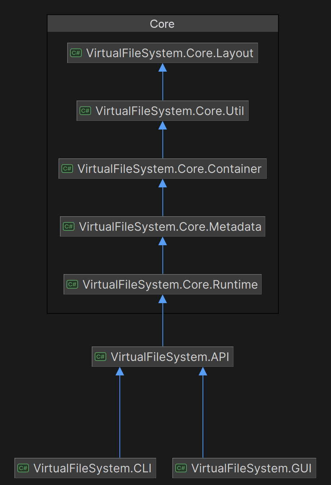

# VirtualFileSystem

A virtual file system written in C# (.NET 9). The whole file system lives inside one container file (`container.vfs`) with its own on-disk format: a superblock, a metadata table, an allocation map, per-block checksums and data blocks. It supports directories, block-level deduplication and CRC-32 integrity checking, and comes with a command-line shell and a Windows GUI.

I built it to understand how a file system works from the bottom up, so most of the pieces (the layout, the allocation, the hash map, the command shell's tokenizer) are written by hand instead of using library helpers.

## Contents

- [Features](#features)
- [Quick start](#quick-start)
- [CLI commands](#cli-commands)
- [Using it as a library](#using-it-as-a-library)
- [How it works](#how-it-works)
- [Architecture](#architecture)
- [Limits](#limits)
- [Known limitations and roadmap](#known-limitations-and-roadmap)
- [License](#license)

## Features

- **Single-file container** with a custom on-disk format, created on first use and re-opened on later runs.
- **Files and directories** with nested folders, `cd`, and recursive folder removal.
- **Import and export** of real files (`cpin` and `cpout`).
- **Large files** through direct block pointers plus one indirect index block.
- **Block-level deduplication.** Identical blocks are stored once and reference-counted.
- **Integrity checking.** Every block read is verified against a stored CRC-32, and corruption raises an error instead of returning bad data.
- **Self-repair on mount.** The allocation map and the deduplication table are rebuilt from the metadata every time the container is opened.
- **Two front ends** over the same API: a command-pattern CLI and a WinForms explorer.
- **Debug mode** that logs every block read, write, allocation, checksum and dedup hit.

## Quick start

You need the [.NET 9 SDK](https://dotnet.microsoft.com/download/dotnet/9.0). The GUI also needs Windows.

```bash
git clone https://github.com/VeselinTodorovv/VirtualFileSystem.git
cd VirtualFileSystem/VirtualFileSystem/VirtualFileSystem.CLI
dotnet run
```

The shell creates `container.vfs` in the folder you run it from. Add `-- --debug` to see the internal log:

```bash
dotnet run -- --debug
```

To start the GUI (Windows only), from the repository root:

```bash
dotnet run --project VirtualFileSystem/VirtualFileSystem.GUI
```

> **Warning:** the container path is opened as a VFS container if it starts with the `VFS1` signature, and **formatted as a new one otherwise**. Only point it at a path that does not exist yet, or at a container this program created.

### Example session

```
VFS> md docs
[OK] Created 'docs'.

VFS> cd docs
[OK] Path changed.

VFS> cpin Samples/oneBlockTest.txt a.txt
[OK] Imported 'Samples/oneBlockTest.txt' as 'a.txt'.

VFS> cpin Samples/oneBlockTest.txt b.txt
[OK] Imported 'Samples/oneBlockTest.txt' as 'b.txt'.

VFS> ls
Name                Size
------------------------------
a.txt               14 bytes

b.txt               14 bytes

VFS> cpout a.txt copy.txt
[OK] Extracted 'a.txt' to 'copy.txt'.

VFS> exit
```

Both files are 14 bytes, so each fits in one zero-padded block with identical contents. The second import finds the first block through the deduplication table and only increases its reference count, so no new data block is used. Run with `--debug` to see it:

```
[FS:DEBUG] [DEDUP] Found existing block 637 for hash 0x...
```

(Block 637 is where the first data block lands with the CLI's default 128-byte blocks.)

The current directory is kept in memory only, so every run starts in the root.

### Try the integrity check

1. Import a file into a fresh container, for example `cpin Samples/oneBlockTest.txt a.txt`, then `exit`.
2. Open `container.vfs` in a hex editor and change one byte at offset `81536` (block 637 × 128 bytes, the first data block with the default CLI settings).
3. Start the shell again and run `cpout a.txt copy.txt`. It reports that the block is corrupted (checksum mismatch).

## CLI commands

| Command | Description |
|---|---|
| `cpin <external-path> <internal-name>` | Copy a real file into the current directory of the virtual file system |
| `cpout <internal-name> <external-path>` | Copy a file out of the virtual file system |
| `ls` | List the files and directories in the current directory |
| `rm <internal-name>` | Remove a file |
| `md <name>` | Create a directory |
| `cd <name>` | Enter a directory. `cd ..` goes up one level and `cd \` goes to the root |
| `rd <name>` | Remove a directory with everything inside it |
| `exit` | Leave the shell |

Names are limited to 32 ASCII characters. The shell splits arguments on spaces and has no quoting, so paths that contain spaces cannot be used with `cpin` and `cpout` yet. `Samples/bigFile.txt` is larger than the direct-block capacity at 128-byte blocks, which makes it a good test for indirect blocks.

## Using it as a library

The `VirtualFileSystem.API` project exposes everything through one interface, which both front ends use.

```csharp
using VirtualFileSystem.API;

IFileSystem fs = new FileSystemService("container.vfs", blockSize: 4096);

fs.Md("docs");
fs.Cd("docs");
fs.Cpin(@"C:\notes\todo.txt", "todo.txt");

foreach (var entry in fs.Ls())
{
    Console.WriteLine($"{entry.Name} {(entry.IsDir ? "<dir>" : $"{entry.Size} bytes")}");
}

fs.Cpout("todo.txt", @"C:\notes\todo-copy.txt");
```

`IFileSystem` is composed of small interfaces: `IFileManager` (`Cpin`, `Cpout`, `Rm`), `IDirectoryManager` (`Md`, `Cd`, `Rd`), `IListing` (`Ls`) and `IFileSystemDebug` (`SetDebug`).

The block size is only used when a container is created. When an existing container is opened, the block size stored in its superblock wins.

## How it works

### On-disk layout

The container is a sequence of fixed-size blocks. The size of each region depends on the block size `B`:

```
block 0                   Superblock         "VFS1" signature, block size, block count, metadata start
blocks 1 .. M             Metadata table     256 fixed-size entries (entry 0 is the root directory)
next F blocks             Allocation map     1 byte per block: 0 = free, 1 = used
next I blocks             Integrity table    one 4-byte CRC-32 per block
remaining blocks          Data blocks        file contents and indirect index blocks

M = ceil(256 × 238 / B)    F = ceil(4096 / B)    I = ceil(4096 × 4 / B)
```

A metadata entry is 238 bytes:

| Offset | Size | Field |
|---|---|---|
| 0 | 1 | In use flag |
| 1 | 1 | Type (file or directory) |
| 2 | 4 | Index of the parent directory |
| 6 | 32 | Name (ASCII, zero padded) |
| 38 | 4 | File size in bytes |
| 42 | 4 | Number of blocks |
| 46 | 192 | 48 block pointers (4 bytes each) |

All offsets and sizes come from constants in `VirtualFileSystem.Core.Layout`, and `FileSystemLayout` calculates the region boundaries.

### Files and large files

A file's first 47 blocks are addressed directly from its metadata entry. Pointer number 48 points to an **indirect index block**, which is a block full of 4-byte pointers to the remaining data blocks. `BlockResolver` translates a logical block number into a physical one, so the reader, the writer and the delete code all share one implementation. This is the same scheme classic Unix file systems use.

The last block of a file is zero padded, and the real length is kept in the metadata.

### Deduplication

While a file is written, each block is hashed with FNV-1a (64 bit). If the hash is already known, the stored block is compared **byte for byte** with the new one. Only a real match is reused, so a hash collision can never corrupt data. Each shared block has a reference count. Removing a file decrements the counts, and a physical block is freed only when its count reaches zero.

The lookup tables are in memory (two chained hash maps, one keyed by hash and one by block index). They are rebuilt on mount by walking the metadata.

### Integrity

Every data block and index block has a CRC-32 in the integrity table. `BlockIO` writes it together with the block and checks it on every read. A mismatch throws an `InvalidDataException` that names the block. The stored value is masked to 31 bits, and `0` means that no checksum has been recorded.

### Mounting and recovery

`FileSystemBootstrapper` either formats a new container or mounts an existing one. When mounting, it treats the allocation map and the deduplication table as derived data: it clears them and rebuilds both from the metadata table, then makes sure the root directory exists. This is the same idea as `fsck`. If the program stops halfway through an import, the half-written file was never marked as in use, and its blocks are simply reclaimed on the next mount.

Import writes in this order: reserve the metadata entry (not yet in use), write the blocks, then mark the entry as in use. Every write is flushed to disk.

## Architecture



| Project | Responsibility |
|---|---|
| `VirtualFileSystem.CLI` | Command shell: command pattern (`ICommand`), dependency injection, hand-written tokenizer and command map |
| `VirtualFileSystem.GUI` | WinForms explorer: list and tree views, import, export, create folder, delete, up and root buttons |
| `VirtualFileSystem.API` | Public surface: `IFileSystem`, `FileSystemService`, `FileEntryInfo` |
| `VirtualFileSystem.Core.Runtime` | The engine: file and directory operations, block I/O, reader and writer, deduplication, integrity, validation and mounting |
| `VirtualFileSystem.Core.Container` | Raw access to the container file (`ContainerStream`) and the block allocator (`FreeBlockMap`) |
| `VirtualFileSystem.Core.Metadata` | Superblock, file and directory entries and their binary serialization, the metadata table |
| `VirtualFileSystem.Core.Layout` | Layout constants and region calculations |
| `VirtualFileSystem.Core.Util` | Hand-written `ChainedHashMap` and `LinkedList`, `BlockResolver`, path state, byte helpers, debug logger |

Design choices worth knowing about:

- `FileSystemContextFactory` is the composition root. It wires the engine together, and the rest of the code receives its dependencies through constructors.
- The operations classes (`FileOperations`, `DirectoryOperations`) contain the logic. `FileSystem` is a thin facade, and `FileSystemService` adapts it to the public interfaces.
- `ChainedHashMap` uses separate chaining over a linked list, a load factor of 0.75 and doubling on resize. The CLI has its own `LinearMap` for the command table.

## Limits

These numbers follow from the layout constants (4096 blocks, 256 metadata entries).

| | CLI (128-byte blocks) | GUI (4096-byte blocks) |
|---|---|---|
| Container file size | 512 KiB | 16 MiB |
| First data block | 637 | 21 |
| Usable data blocks | 3,459 (about 432 KiB) | 4,075 (about 15.9 MiB) |
| Largest single file | 10,112 bytes | 4,386,816 bytes (about 4.2 MiB) |

The largest file is `(47 + B / 4) × B` bytes. Files and directories share 255 metadata entries (entry 0 is the root). The CLI and the GUI use different default block sizes, but a container keeps the block size it was created with.

## Known limitations and roadmap

- **Disk full is not handled.** Running out of free blocks fails the import with an exception instead of a clear message, and can leave temporary state until the next mount.
- **A damaged container can be reformatted.** A file without the `VFS1` signature is treated as new. Opening should fail instead.
- **A corrupted indirect index block can prevent mounting**, because the rebuild reads every index block.
- **No checksums on the superblock and the metadata table**, only on data and index blocks.
- **Names are ASCII only**, at most 32 characters, with no path syntax. `cd` moves one level at a time.
- **Fixed geometry.** 4096 blocks and 256 entries per container.
- **Single process.** The container file is opened exclusively, and the API has no disposal hook yet.
- **Performance.** Every block write is flushed, and lookups scan the metadata table from disk.
- **GUI.** Import and export run on the UI thread, and the tree only shows the current folder.
- **No automated tests yet.** Good candidates: deduplication and reference counting, indirect-block round trips, checksum failure, and remounting after an interrupted import.

## License

MIT. See [LICENSE](LICENSE).
